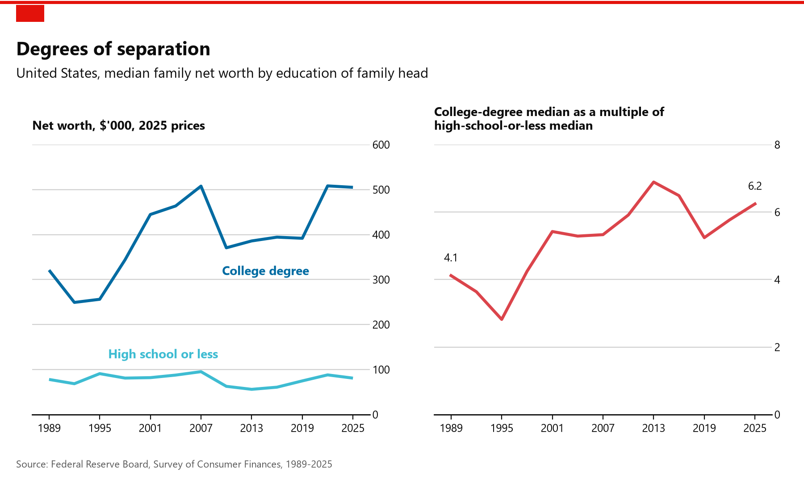

# The US wealth gap by education, 1989–2025

This project tracks how the wealth gap between two kinds of US families has changed since 1989:

- families headed by someone with a **college degree**
- families headed by someone with a **high school education or less**



The figure has two panels:

- **Left:** median family net worth for each group, in 2025 dollars.
- **Right:** the college-degree median divided by the high-school-or-less median.

That ratio rose from **4.1× in 1989 to 6.2× in 2025**:

- The college-degree median grew from about $321K to $505K.
- The high-school-or-less median stayed between roughly $55K and $95K, ending at $81K.

## Data

The data come from the Federal Reserve Board's [Survey of Consumer Finances](https://www.federalreserve.gov/econres/scfindex.htm) (SCF), using the **Summary Extract Public Data** for every survey from 1989 to 2025. The file for each year is `scfp{YEAR}excel.zip`.

- **Dollars:** the Fed publishes every year's extract already adjusted to 2025 dollars, so the scripts make no inflation adjustment.
- **Education:** `EDCL` is the education of the family's *reference person* (the household head).
  - `EDCL` 4 is a college degree.
  - `EDCL` 1–2 is high school or less.
  - The SCF only began asking about respondents' own parents' education in 2016, so that question can't cover 1989–2025.
- **Statistics:** these are weighted medians (`WGT`), with all five implicates (the survey's five imputed copies of each family) pooled together. This is the Fed's own method. The college-degree and some-college medians match the Fed's published historic tables (Table 4) exactly. The Fed doesn't publish a combined high-school-or-less group.

## Rerunning

You need Python 3, plus the packages in `requirements.txt` (pandas, numpy and matplotlib).

```bash
pip install -r requirements.txt
```
```bash
python get_data.py
```
```bash
python plot_economist.py
```

| Script | What it does |
|---|---|
| `get_data.py` | Downloads the 13 extracts to `data/raw/` (about 35 MB, not tracked by git; skipped if already present). Writes `data/scf_networth_by_education.csv`: median and mean net worth, share of families and sample size, by year and education group. |
| `plot_economist.py` | Draws the figure above, styled after The Economist's charts, to `figures/networth_gap_economist.png`. |
| `plot.py` | Draws a plainer version of the same chart to `figures/networth_gap_by_education.png`. |
